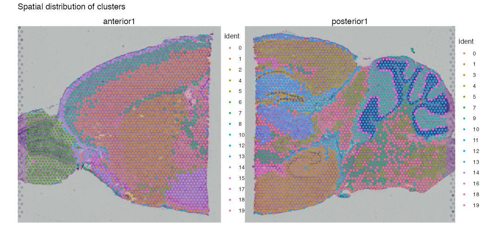
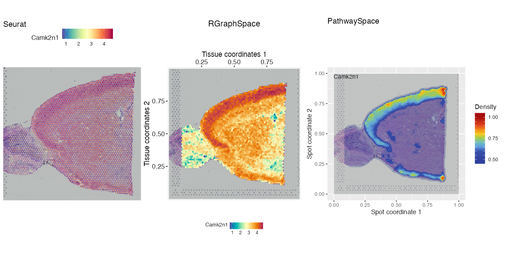
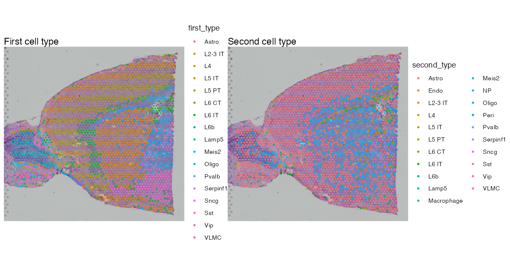

# Spatial Transcriptomics in R: An Annotated Beginner Walkthrough

**Edition by Dr. Seed (@DrSeed)**

A single, English-language R Markdown walkthrough of a full spatial transcriptomics
analysis: quality control, clustering, differential expression, spatially variable
genes, cell-type deconvolution, cell-cell communication and cell segmentation. Every
code chunk has a plain-language explanation above it, written for readers with no
spatial-transcriptomics background.

## Based on

This is an adapted edition of the course
**Analysis of Spatial Transcriptomic Data** by
**Flávio Gabriel Carazza-Kessler and Carolina Saibro-Girardi**
(<https://github.com/flaviogckessler/Curso_ST>), which includes material adapted
from the Sysbiolab Team's RGraphSpace and PathwaySpace vignettes
(Mauro A. A. Castro et al.).

## What I changed

- Translated the code and text from Portuguese to English
- Wrote a beginner explanation box ("What this chunk does / Why / What to look for")
  above every code chunk, plus a background section on the underlying concepts
- Merged all class vignettes into one file with a single `data/`, `images/`,
  `results/` folder layout
- Updated code for current Seurat (v5) and spacexr versions
- Moved the optional raw Xenium preparation into an appendix

## Contents

| Part | Topic | Tools |
|----|----|----|
| 1 | Environment setup | CRAN, Bioconductor, GitHub |
| 2A | QC, normalization, clustering, DE, spatially variable genes | Seurat, SCTransform |
| 2B | Continuous signal visualization | RGraphSpace, PathwaySpace |
| 3A | Cell-type deconvolution | RCTD (spacexr) |
| 3B | Cell-cell communication | CellChat, PathwaySpace |
| 3C | Cell segmentation (Xenium) | RGraphSpace, sf |

Main file: [`Spatial_Transcriptomics_Course_Annotated.Rmd`](Spatial_Transcriptomics_Course_Annotated.Rmd)

## Example output

## How to run

1. Requires R 4.5.0 or newer. RCTD (Part 3A) needs about 20 GB of RAM.
2. Clone this repository, open the `.Rmd` in RStudio, and edit `project_dir` in the
   `define-directories` chunk to point to your copy.
3. Run the chunks in order. Large data files (the `stxBrain` dataset, the Allen
   cortex reference, the Xenium crop) are downloaded by the code and are not stored
   in this repository.

## License

- **Code:** MIT License. Copyright (c) 2026 Flávio Gabriel Carazza-Kessler and
  Carolina Saibro-Girardi. Modifications copyright (c) 2026 Dr. Seed (@DrSeed).
- **Text:** [CC BY-NC 4.0](https://creativecommons.org/licenses/by-nc/4.0/).
  The original text is by the course authors above, and this edition has been
  translated and adapted. It may not be used commercially.
